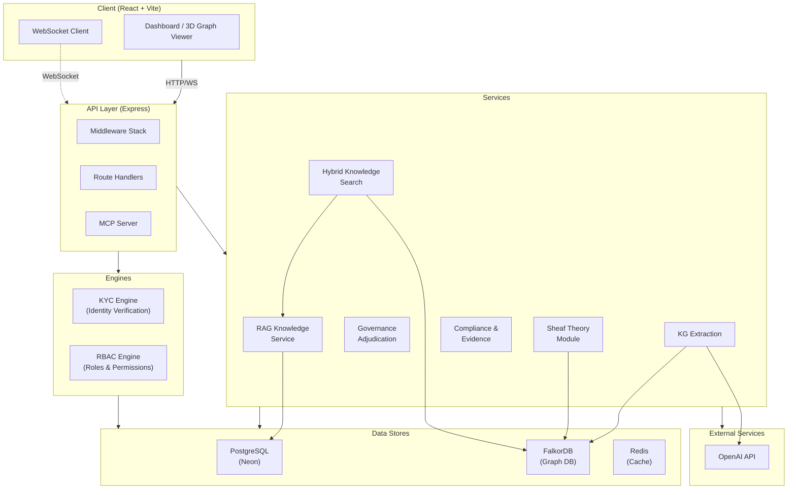
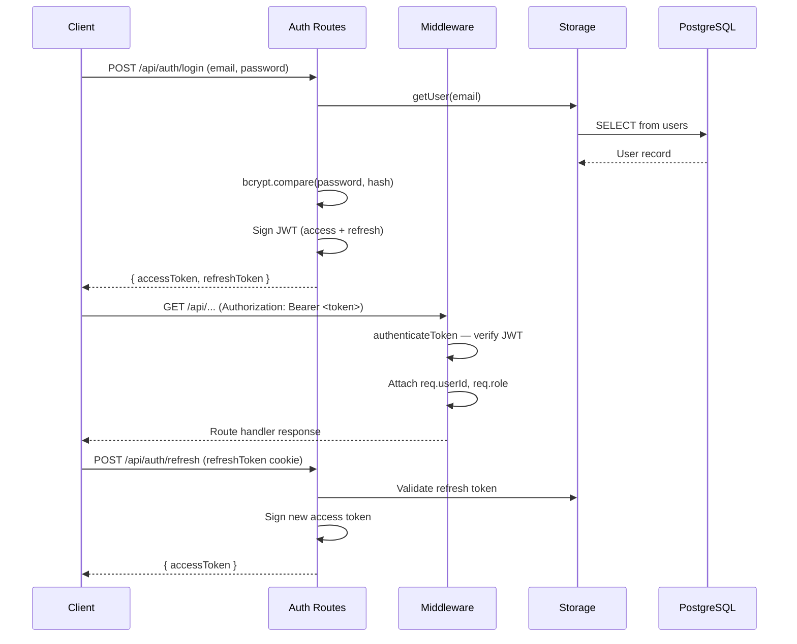

# wtrdb Architecture

## Table of Contents

- [1. Executive Summary](#1-executive-summary)
- [2. System Architecture Overview](#2-system-architecture-overview)
- [3. Monorepo Structure](#3-monorepo-structure)
- [4. Server Architecture](#4-server-architecture)
- [5. Mathematical Engine (Sheaf Theory)](#5-mathematical-engine-sheaf-theory)
- [6. Database Schema](#6-database-schema)
- [7. External Integrations](#7-external-integrations)
- [8. Authentication and Authorization](#8-authentication-and-authorization)
- [9. Real-Time Architecture](#9-real-time-architecture)
- [10. Build and Development](#10-build-and-development)
- [11. Deployment](#11-deployment)
- [12. Technology Stack](#12-technology-stack)

---

## 1. Executive Summary

**wtrdb** is a knowledge graph construction, quality measurement, and access control platform. It transforms text, images, video, and live databases into queryable knowledge graphs backed by mathematical quality guarantees derived from cellular sheaf theory.

### Core Value Proposition

Source material is ingested into per-knowledge-base graphs stored in FalkorDB. An incremental extraction pipeline pulls entities and relationships from content chunks, routes them through a three-filter governance adjudication pipeline, and writes validated triples to the graph. Video and image sources run through the dedicated video-kg and image-kg services, which write the same graphs. Quality is measured continuously via sheaf Laplacian spectral analysis, cohomology-based conflict detection, and sheaf diffusion for automated resolution.

### Stack Summary

| Layer | Technology |
|-------|-----------|
| Frontend | React 18, Vite, shadcn/UI, Tailwind CSS, Three.js |
| API | Express 4, JWT auth, RBAC |
| Graph Database | FalkorDB (Redis-based graph DB, Cypher queries) |
| Relational Database | PostgreSQL, Drizzle ORM |
| AI | OpenAI GPT-5 (extraction), GPT-5 (embeddings) |
| Math Engine | Cellular sheaf theory (custom TypeScript implementation) |
| Build | Nx monorepo, esbuild (server), Vite (client) |

---

## 2. System Architecture Overview



### Layer Responsibilities

| Layer | Responsibility |
|-------|---------------|
| **API** | Express HTTP + WebSocket server; authentication, RBAC, rate limiting, correlation tracing |
| **Data Stores** | PostgreSQL for relational data, FalkorDB for graph data, Redis for queues and caching |

---

## 3. Monorepo Structure

```
wtrdb/
├── apps/
│   ├── client/              # React + Vite frontend
│   │   ├── src/
│   │   │   ├── components/  # UI components (shadcn/UI, knowledge-graph/)
│   │   │   ├── hooks/       # Custom React hooks
│   │   │   ├── pages/       # Route pages
│   │   │   └── lib/         # Utilities
│   │   └── tailwind.config.ts
│   ├── server/              # Express API server
│   │   └── src/             # (see Section 4)
│   │   └── src/
│   └── docs/                # Nextra documentation site
│       ├── pages/
│       └── next.config.js
├── libs/
│   ├── shared/              # Shared schemas and types
│   │   └── src/
│   │       ├── schema.ts           # Drizzle ORM table definitions
│   │       ├── knowledge-graph-types.ts  # Graph entity/relationship types
│   │       └── index.ts
│   └── core/                # Shared utilities
│       └── src/
│           ├── logger.ts    # Structured logger
│           ├── errors.ts    # Error classes
│           ├── response.ts  # API response helpers
│           ├── validate.ts  # Zod validation helpers
│           └── constants.ts
├── migrations/              # Drizzle SQL migrations
├── package.json             # Root workspace config
├── nx.json                  # Nx workspace config
└── drizzle.config.ts        # Drizzle Kit config
```

### Build Commands

| Command | Description |
|---------|------------|
| `npm run dev` | Start server in development mode (Vite HMR) |
| `npm run dev:docs` | Start documentation site on port 3001 |
| `npm run build` | Build client and server for production |
| `npm run build:client` | Build client only (Vite) |
| `npm run build:server` | Build server only (esbuild) |
| `npm run start` | Start production server |
| `npm run db:push` | Push schema changes to database |
| `npm run db:generate` | Generate migration SQL |
| `npm run db:seed` | Run all seed scripts |
| `npm run lint` | Lint all projects |
| `npm run graph` | Visualize Nx dependency graph |

---

## 4. Server Architecture

### Directory Structure

```
apps/server/src/
├── engines/
│   │   ├── config.ts        # Redis keys, queue names, timeouts
│   │   └── services/        # Context resolver
│   ├── kyc/                 # Know-Your-Customer identity engine
│   │   ├── config/          # KYC configuration
│   │   ├── routes/          # KYC REST endpoints
│   │   ├── services/        # KYC verification logic
│   │   └── types.ts
│   ├── rbac/                # Role-Based Access Control engine
│   │   ├── services/        # role, permission, team, scope services
│   │   └── index.ts         # Engine init (seeds system roles)
├── infrastructure/
│   ├── database/            # PostgreSQL connection pool
│   ├── falkordb/            # FalkorDB pool manager + typed client
│   ├── openai/              # OpenAI connection pool manager
│   ├── websocket/           # WebSocket connection manager
│   └── index.ts             # Centralized infrastructure exports
├── middleware/
│   ├── auth.ts              # JWT authentication + role guards
│   ├── admin-auth.ts        # Admin authentication
│   ├── rbac.middleware.ts   # RBAC context resolution
│   ├── viewer-guard.ts      # Read-only demo mode guard
│   ├── hybrid-auth.ts       # Hybrid auth (JWT or API key)
│   ├── concurrency.middleware.ts  # Concurrency limit enforcement
│   ├── correlation-id.ts    # Distributed request tracing
│   ├── rateLimiter.ts       # Rate limiting
│   ├── webhookValidation.ts # Webhook signature validation
│   └── errorHandler.ts      # Error formatting
├── mcp/
│   └── server.ts            # Model Context Protocol server
├── modules/                 # LEGACY — to clean
│   ├── avatar/              # Deprecated (legacy)
│   ├── long-running-tasks/  # Deprecated
│   └── question-sets/       # Deprecated
├── plugins/
│   ├── loader.ts            # Plugin discovery
│   └── team-management-adapter.ts  # Team management middleware
├── routes/                  # (see Routes table below)
├── services/                # (see Services table below)
├── storage.ts               # Data access layer
├── db.ts                    # Drizzle database instance
└── index.ts                 # Server startup entry point
```

### Engines

| Engine | Directory | Purpose |
|--------|-----------|---------|
| **KYC** | `engines/kyc/` | Know-Your-Customer identity verification: document types, verification status, settings |
| **RBAC** | `engines/rbac/` | Enterprise role-based access control: system roles, custom roles, permissions, team scoping, audit |

### Services

| Service | File | Domain |
|---------|------|--------|
| **KG Extraction** | `knowledge-graph-extraction.ts` | Incremental entity/relationship extraction from document chunks |
| **KG Prompts** | `knowledge-graph-prompts.ts` | OpenAI prompt templates, entity type taxonomy (13 types), dual-track routing |
| **KG Query** | `knowledge-graph-query.ts` | Read-only Cypher queries against FalkorDB graphs |
| **KG Events** | `kg-extraction-events.ts` | Extraction event logging to database and WebSocket |
| **Governance** | `governance-adjudication.ts` | Three-filter pipeline: evidence, logical, evolutionary-intent verification |
| **Hybrid Search** | `hybrid-knowledge-search.ts` | Combined vector RAG + graph traversal search with graceful degradation |
| **Sheaf Module** | `sheaf/` | Mathematical engine (4 files, see Section 5) |
| **RAG Knowledge** | `rag-knowledge.ts` | Vector-based document retrieval, chunk management, storage limits |
| **Compliance Audit** | `compliance-audit-bridge.ts` | Audit event bridge for compliance frameworks |
| **Compliance Auto** | `compliance-auto-configure.ts` | One-click compliance framework auto-configuration |
| **Compliance Evidence** | `compliance-evidence-collector.ts` | Automated evidence collection for compliance controls |
| **Compliance Export** | `compliance-export.service.ts` | Evidence export per framework |
| **Compliance Frameworks** | `compliance-frameworks-all.ts`, `-extended.ts`, `-extra.ts` | Framework definitions (CMMC, SOC 2, HIPAA, etc.) |
| **Compliance Report** | `compliance-report.service.ts` | Compliance report generation |
| **CMMC Evidence** | `cmmc-evidence/` | Per-domain evidence collectors (AC, AU, CM, IA, IR, SC/SI) |
| **MFA** | `mfa.service.ts` | TOTP-based multi-factor authentication (CMMC IA.2.081) |
| **Audit Log** | `audit-log.ts` | Structured audit event recording |
| **Email** | `email-service.ts` | Transactional email with database-configured SMTP |
| **Notification** | `notification-service.ts` | In-app notification delivery |
| **Webhook Delivery** | `webhook-delivery.ts` | Outbound webhook dispatch |
| **Webhook Retry** | `webhook-retry-service.ts` | Exponential backoff retry for failed webhooks |
| **Webhook Test** | `webhook-test-service.ts` | Webhook endpoint testing |
| **Universal Webhook** | `universal-webhook-tool.ts` | Generic webhook tool for agent-worker |
| **Health Check** | `startup-health-check.ts` | Startup integration health verification |
| **Graceful Shutdown** | `graceful-shutdown.ts` | SIGTERM/SIGINT handling, connection draining |
| **Resource Watchdog** | `resource-watchdog.ts` | Memory/CPU monitoring with auto-restart |

### Routes

| File | Prefix | Purpose |
|------|--------|---------|
| `public-routes.ts` | `/api/` | Installer, health, branding, SEO, public stats, contact form |
| `auth-routes.ts` | `/api/auth/` | Login, register, OTP, password reset, token refresh |
| `mfa-routes.ts` | `/api/mfa/` | TOTP setup, verify, disable, status |
| `admin-routes.ts` | `/api/admin/` | User management, plans, credit packages, global settings |
| `admin-team-access.routes.ts` | `/api/admin/` | Read-only admin analytics for team members |
| `llm-models-routes.ts` | `/api/admin/llm-models/` | LLM model CRUD (admin) |
| `email-settings-routes.ts` | `/api/admin/email-settings/` | SMTP configuration (admin) |
| `rag-knowledge-routes.ts` | `/api/rag-knowledge/` | Knowledge base CRUD, document upload, chunk management |
| `knowledge-graph-routes.ts` | `/api/knowledge-graph/` | Graph generation, entity/relationship queries, natural-language query |
| `rbac-routes.ts` | `/api/rbac/` | Teams, roles, permissions, user-role assignments, audit events |
| `compliance-routes.ts` | `/api/compliance/` | Report generation, security posture, control verification |
| `compliance-settings-routes.ts` | `/api/compliance/` | Compliance settings, framework toggle, evidence CRUD, scheduled reports |
| `notification-routes.ts` | `/api/notifications/` | List, read, dismiss, banner, admin broadcast |
| `user-webhook-routes.ts` | `/api/webhooks/` | Webhook subscription CRUD, test, delivery logs, retry |
| `internal-tools-routes.ts` | `/api/internal/tools/` | Agent-worker tool endpoints (KB lookup, graph query, webhook) |
| `mcp-routes.ts` | `/api/mcp-servers/` | MCP server registry (stubbed in current extraction) |
| `webhook-routes.ts` | — | Legacy webhook handlers (removed, stub file) |

### Middleware Stack (Registration Order)

The middleware is registered in `index.ts` and `routes.ts` in this order:

1. **`express.json()`** — Body parser (10 MB limit, raw body capture)
2. **`express.urlencoded()`** — URL-encoded body parser
3. **`cookieParser()`** — Cookie parsing for refresh tokens
4. **`/uploads` static** — Serve uploaded files
5. **`/images` static** — Serve static images
6. **`correlationIdMiddleware`** — Attach correlation ID for distributed tracing
7. **`X-Author` / `X-Powered-By`** — Attribution headers
8. **`/health`** — Simple health check (no auth)
9. **`/health/detailed`** — Detailed health check with integration status
10. **Request logger** — Log API requests with correlation ID, method, path, status, duration
11. **Public routes** — Unauthenticated endpoints (installer, branding, SEO)
12. **Auth routes** — Login, register, OTP, password reset
13. **MFA routes** — TOTP setup and verification
14. **`viewerGuard`** — Block mutations for viewer-role users (demo mode)
15. **Team context middleware** — Team management plugin (if installed)
16. **Authenticated routes** — All remaining routes require JWT
17. **Global error handler** — JSON error responses with correlation ID
18. **API 404 handler** — Catch unmatched `/api/*` routes
19. **Vite/static** — SPA serving (Vite in dev, static in production)

---

## 5. Mathematical Engine (Sheaf Theory)

The sheaf module (`apps/server/src/services/sheaf/`) implements the mathematical core for measuring and resolving consistency across knowledge graphs using cellular sheaf theory.

### Sheaf Module Files

| File | Purpose | Key Formulas |
|------|---------|-------------|
| `sheaf-construction.ts` | Builds cellular sheaf F over a knowledge graph G = (V, E). Assigns stalk vector spaces F(v) to vertices and F(e) to edges, with restriction maps F_{v<e} : F(v) -> F(e). Entity stalks use OpenAI `text-embedding-3-small` embeddings projected to configured stalk dimension. | F(v) ~ R^d, restriction via outer-product approximation |
| `sheaf-laplacian.ts` | Computes the sheaf Laplacian L_F = (delta^0)^T delta^0 and spectral data. The spectral gap measures global consistency. | L_F = (delta^0)^T delta^0, conflict energy E = x^T L_F x |
| `sheaf-cohomology.ts` | Computes H^0 (global sections / consistent components) and H^1 (conflict cycles). Detects structural inconsistencies across knowledge graphs. | dim(H^0) = connected consistent components, dim(H^1) = independent conflict cycles |
| `sheaf-diffusion.ts` | Runs the heat equation dh/dt = -L_F h for automated conflict resolution. Iteratively smooths section vectors toward consistency. | dh/dt = -L_F h, convergence ~ 1/spectral_gap |

### Academic Citations

- Gebhart, T. et al. "Knowledge Sheaves." arXiv:2110.03789, 2023.
- Hansen, J. and Ghrist, R. "Toward a Spectral Theory of Cellular Sheaves." 2019.
- Bodnar, C. et al. "Neural Sheaf Diffusion." NeurIPS 2022.
- Robinson, M. "Sheaves Are the Canonical Data Structure for Sensor Integration." 2017.
- Ayzenberg, A. et al. "Sheaf Theory: From Deep Geometry to Deep Learning." 2025.

### Exported API

```typescript
// Construction
constructCellularSheaf(graphName) -> CellularSheaf
constructCellularSheafFromData(vertices, edges) -> CellularSheaf
constructSheafForKnowledgeBase(kbId) -> CellularSheaf

// Laplacian
computeSheafLaplacian(sheaf) -> SheafLaplacian  // includes consistency score
spectralGap(laplacian) -> number

// Cohomology
computeSheafCohomology(sheaf) -> CohomologyResult  // conflict cycles
isGloballyConsistent(result) -> boolean

// Diffusion
runSheafDiffusion(sheaf) -> DiffusionResult  // smoothed sections
applyDiffusionToSheaf(sheaf) -> DiffusionResult
```

### Extraction Pipeline

The knowledge graph extraction pipeline (`knowledge-graph-extraction.ts`) implements incremental extraction from document chunks:

**Incremental Extraction (WS3-T1.1)**
- Only processes new/unprocessed chunks
- Tracks `extractedAt` timestamp per chunk
- Graph update rule: V_k = V_{k-1} U V_k^+, E_k = (E_{k-1} \ E_k^down) U E_k^+

**Dual-Track Routing (WS3-T1.2)**
- STATIC track: entities + relationships as triples (h, r, t)
- EVENT track: event structures epsilon = (trigger, roles, time, intent) where intent in {Informational, Evolutionary}
- Evolutionary events trigger soft deprecation of existing facts

**Entity Type Taxonomy (13 types)**

| Entity Type | Description |
|-------------|------------|
| Person | Individual people |
| Organization | Companies, institutions |
| Concept | Abstract ideas, theories |
| Technology | Software, hardware, protocols |
| Location | Physical or virtual places |
| Event | Occurrences, incidents |
| Product | Products, offerings |
| Document | Documents, specifications |
| Configuration | Settings, parameters |
| Credential | Keys, certificates, tokens |
| Policy | Rules, regulations |
| Service | Running services, APIs |
| Infrastructure | Servers, networks, platforms |

**Governance Adjudication (WS3-T1.3)**

Three-filter pipeline applied per chunk before writing to graph:

1. **Evidence Verification** — LLM judges whether extracted facts are actually supported by the source text
2. **Logical Verification** — Rejects contradictions and type violations against the existing graph
3. **Evolutionary-Intent Verification** — Classifies evolutionary events and triggers soft deprecation (status='Deprecated', _invalidAt=now())

Design principle: conservative acceptance. Facts are only rejected if evidence actively contradicts them. Ambiguous facts are accepted with lower confidence. Nothing is ever physically deleted.

Reference: Bao, W. et al. "DIAL-KG: Schema-Free Incremental Knowledge Graph Construction via Dynamic Schema Induction and Evolution-Intent Assessment." arXiv:2603.20059, 2026.

References:
- Spivak, D. "Functorial Data Migration." 2012.
- Robinson, M. "Sheaves for Sensor Integration." 2017.

---

## 6. Database Schema

### PostgreSQL Tables (Drizzle ORM)

All tables are defined in `libs/shared/src/schema.ts`.

#### Identity and Authentication

| Table | Purpose |
|-------|---------|
| `users` | User accounts (email, password hash, role, plan, credits, MFA secret) |
| `otp_verifications` | One-time password codes for email verification |
| `refresh_tokens` | JWT refresh token storage |

#### Knowledge Management

| Table | Purpose |
|-------|---------|
| `knowledge_base` | Knowledge base metadata (name, description, user ownership) |
| `knowledge_chunks` | Document chunks with embeddings for RAG retrieval |
| `knowledge_processing_queue` | Async document processing queue |
| `user_knowledge_storage_limits` | Per-user storage quotas |

#### Knowledge Graph

| Table | Purpose |
|-------|---------|
| `knowledge_graphs` | Graph metadata per knowledge base (stats, extraction status, quality scores) |
| `merge_conflicts` | Merge conflict records with resolution status |
| `schema_proposals` | Schema evolution proposals from extraction |
| `kg_extraction_events` | Extraction pipeline event log |

#### RBAC and Organizations

| Table | Purpose |
|-------|---------|
| `organizations` | Organization accounts |
| `organization_members` | Org-to-user membership |
| `teams` | Team hierarchy within organizations |
| `roles` | System and custom role definitions |
| `permissions` | Permission definitions |
| `role_permissions` | Role-to-permission assignments |
| `user_roles` | User-to-role assignments (with optional team scope) |
| `rbac_audit_events` | RBAC action audit trail |

#### Concurrency

| Table | Purpose |
|-------|---------|
| `concurrency_limits` | Per-user concurrency quotas |
| `concurrency_allocations` | Active concurrency allocations |
| `concurrency_sessions` | Concurrency session tracking |

#### Platform Configuration

| Table | Purpose |
|-------|---------|
| `global_settings` | Platform-wide settings (key-value) |
| `llm_models` | Available LLM model registry |
| `prompt_templates` | Reusable prompt templates |
| `email_templates` | Email template definitions |
| `email_notification_settings` | Email notification preferences |
| `notifications` | In-app notification records |
| `banned_words` | Content moderation word list |
| `seo_settings` | SEO configuration |
| `analytics_scripts` | Analytics tracking scripts |

#### Webhooks

| Table | Purpose |
|-------|---------|
| `webhook_subscriptions` | User webhook endpoint registrations |
| `webhook_logs` | Webhook delivery attempt logs |

#### Data Connections

| Table | Purpose |
|-------|---------|
| `data_connections` | External data source connections |
| `data_schema_cache` | Cached schemas from connected sources |
| `semantic_mappings` | Semantic field mappings for data import |
| `query_history` | Data query execution history |

#### MCP and Integrations

| Table | Purpose |
|-------|---------|
| `org_mcp_servers` | Organization MCP server registrations |

> **Note**: Several legacy tables from a prior product iteration remain in the schema but are unused and scheduled for removal in a future migration.

### FalkorDB Naming Conventions

| Pattern | Usage |
|---------|-------|
| `kg_{userId}_{knowledgeBaseId}` | Per-knowledge-base graph |

All FalkorDB graph names are generated by the `getGraphName()` helper in `infrastructure/falkordb/client.ts`.

---

## 7. External Integrations

### OpenAI

| Usage | Model | Purpose |
|-------|-------|---------|
| Entity extraction | GPT-5 | Extract entities and relationships from document chunks |
| Embeddings | GPT-5 | Generate stalk vectors for sheaf construction |
| Governance adjudication | GPT-5 | Evidence and logical verification filters |
| Natural-language query | GPT-5 | Translate user questions to Cypher queries |

Connection pooling managed by `infrastructure/openai/pool-manager.ts`.

### FalkorDB

Redis-based graph database using the Cypher query language. Stores knowledge graphs as labeled property graphs with typed entities and relationships.

- **Pool Manager**: `infrastructure/falkordb/pool-manager.ts` — connection pooling, health checks
- **Typed Client**: `infrastructure/falkordb/client.ts` — query execution, graph name helpers, result typing
- **Initialization**: Non-blocking at startup; graph features gracefully degrade if unavailable

### PostgreSQL (Neon Serverless)

Primary relational database for all platform metadata, user data, and configuration.

- **Connection Pool**: `infrastructure/database/connection-pool.ts`
- **ORM**: Drizzle ORM with Zod validation (`drizzle-zod`)
- **Migrations**: SQL migrations in `/migrations/`, managed by `drizzle-kit`

### Redis

- **IORedis** client for concurrency counters and the RBAC permission cache

### MCP (Model Context Protocol)

Server-side MCP implementation in `mcp/server.ts` for exposing platform tools to AI agents. Registered at startup via `registerMcpRoutes()`.

---

## 8. Authentication and Authorization

### JWT Authentication Flow



### RBAC (Role-Based Access Control)

The RBAC engine (`engines/rbac/`) provides enterprise-grade access control:

- **System Roles**: Seeded on first startup (admin, manager, user, viewer)
- **Custom Roles**: Organizations can define custom roles with specific permissions
- **Team Scoping**: Roles can be scoped to specific teams within an organization
- **Permission Model**: Fine-grained permissions assigned to roles via `role_permissions` join table
- **User Assignment**: Users receive roles via `user_roles` (optionally scoped to a team)
- **Audit Trail**: All RBAC changes logged to `rbac_audit_events`

### Role Guards

| Guard | Location | Purpose |
|-------|----------|---------|
| `authenticateToken` | `middleware/auth.ts` | Verify JWT, attach userId and role to request |
| `requireRole(roles...)` | `middleware/auth.ts` | Restrict route to specific roles |
| `checkAdmin` / `checkAdminWithReadOnly` | `middleware/admin-auth.ts` | Admin-only access (with optional read-only) |
| `viewerGuard` | `middleware/viewer-guard.ts` | Block all mutations for viewer-role users |
| `resolveRbacContext` | `middleware/rbac.middleware.ts` | Resolve org/team context for RBAC checks |
| `authenticateHybrid` | `middleware/hybrid-auth.ts` | Accept JWT or API key authentication |

### Multi-Factor Authentication (MFA)

TOTP-based MFA following CMMC IA.2.081:

- **Setup**: `POST /api/mfa/setup` — generate TOTP secret and QR code
- **Verify Setup**: `POST /api/mfa/verify-setup` — confirm TOTP code
- **Login Verify**: `POST /api/mfa/verify-login` — verify TOTP during login
- **Disable**: `POST /api/mfa/disable` — disable MFA (requires current TOTP)
- **Status**: `GET /api/mfa/status` — check MFA enrollment

---

## 9. Real-Time Architecture

### WebSocket

The WebSocket connection manager (`infrastructure/websocket/connection-manager.ts`) provides:

- Persistent connections per authenticated user
- Server-push events for extraction progress, graph updates, and notifications
- Connection lifecycle management (heartbeat, reconnection)

### Extraction Events

During knowledge graph extraction, events are emitted to both the `kg_extraction_events` database table and via WebSocket to connected clients:

- Chunk processing started/completed
- Entity/relationship extracted
- Governance adjudication results (accepted/rejected/deprecated)
- Extraction pipeline completion with summary statistics

---

## 10. Build and Development

### Development Commands

| Command | Description |
|---------|------------|
| `npm run dev` | Start development server with Vite HMR (port 5000) |
| `npm run dev:docs` | Start Nextra docs site (port 3001) |
| `npm run dev:all` | Start both server and docs concurrently |
| `npm run dev:client` | Start client only via Nx |
| `npm run dev:server` | Start server only via Nx |

### Database Commands

| Command | Description |
|---------|------------|
| `npm run db:push` | Push schema changes directly (development) |
| `npm run db:generate` | Generate SQL migration files |
| `npm run db:seed` | Run all seed scripts (`apps/server/src/seed-all.ts`) |

### Testing Commands

| Command | Description |
|---------|------------|
| `npm run test:credits:smoke` | Smoke test for credit system |
| `npm run test:credits` | Full credit feature test suite |
| `npm run test:credits:all` | Run both credit test suites |

### Seed Scripts

The seed runner (`apps/server/src/seed-all.ts`) bootstraps the database with:
- Default plans and credit packages
- System roles and permissions (via RBAC engine init)
- Default LLM model configurations
- Global settings defaults

---

## 11. Deployment

### PM2 Process Management

The production server runs under PM2:

- **Start**: `NODE_ENV=production node dist/apps/server/index.js`
- **Ready Signal**: `signalReady()` notifies PM2 the process is accepting connections
- **Graceful Shutdown**: Handles SIGTERM/SIGINT, drains connections, closes pools

### Health Endpoints

| Endpoint | Auth | Purpose |
|----------|------|---------|
| `GET /health` | None | Simple liveness check (`{ status: "ok" }`) |
| `GET /health/detailed` | None | Integration status (PostgreSQL, FalkorDB, Redis, OpenAI) |

Response codes: 200 (healthy/degraded), 503 (unhealthy).

### Startup Sequence

1. Setup global error handlers and shutdown signals
2. Initialize required directories
3. Configure Express middleware stack
4. Initialize email service from database settings
5. Initialize FalkorDB pool (non-blocking, graceful degradation)
6. Run startup health checks
7. Preload JWT expiry settings
8. Register MCP endpoints
9. Register all route handlers
10. Start HTTP server on configured port (default: 5000)
11. Start resource watchdog
12. Start webhook retry service
13. Signal PM2 ready

### Resource Watchdog

The `resource-watchdog.ts` service monitors memory and CPU usage, triggering alerts or auto-restart when thresholds are exceeded.

---

## 12. Technology Stack

### Runtime Dependencies

| Package | Version | Purpose |
|---------|---------|---------|
| `express` | ^4.22.1 | HTTP server framework |
| `pg` | ^8.16.3 | PostgreSQL client |
| `@neondatabase/serverless` | ^0.10.4 | Neon serverless PostgreSQL driver |
| `drizzle-orm` | ^0.39.1 | TypeScript ORM |
| `drizzle-zod` | ^0.7.0 | Drizzle-Zod schema integration |
| `openai` | ^6.9.1 | OpenAI API client |
| `ioredis` | ^5.10.1 | Redis client |
| `jsonwebtoken` | ^9.0.2 | JWT signing and verification |
| `bcrypt` | ^6.0.0 | Password hashing |
| `zod` | ^3.25.76 | Runtime type validation |
| `ws` | ^8.18.3 | WebSocket server |
| `multer` | ^2.0.2 | File upload handling |
| `pm2` | ^6.0.14 | Process management |
| `cookie-parser` | ^1.4.7 | Cookie parsing |
| `passport` | ^0.7.0 | Authentication framework |
| `passport-local` | ^1.0.0 | Local strategy for Passport |
| `stripe` | ^19.2.0 | Payment processing |
| `axios` | ^1.13.2 | HTTP client |
| `pdf-parse` | ^2.4.5 | PDF text extraction |
| `pdf-lib` | ^1.17.1 | PDF generation/manipulation |
| `pdfkit` | ^0.17.2 | PDF document creation |
| `papaparse` | ^5.5.3 | CSV parsing |
| `archiver` | ^7.0.1 | ZIP archive creation |
| `adm-zip` | ^0.5.16 | ZIP file reading |
| `dotenv` | ^17.2.3 | Environment variable loading |
| `@modelcontextprotocol/sdk` | ^1.27.1 | MCP protocol implementation |
| `@aws-sdk/client-s3` | ^3.984.0 | S3 object storage |
| `swagger-ui-express` | ^5.0.1 | API documentation UI |
| `redoc-express` | ^2.1.3 | Alternative API documentation UI |
| `i18next` | ^25.6.3 | Internationalization |

### Frontend Dependencies

| Package | Version | Purpose |
|---------|---------|---------|
| `react` | ^18.3.1 | UI library |
| `react-dom` | ^18.3.1 | React DOM renderer |
| `three` | ^0.183.2 | 3D knowledge graph visualization (WebGL) |
| `@xyflow/react` | ^12.9.3 | 2D graph/flow visualization |
| `wouter` | ^3.3.5 | Client-side routing |
| `@tanstack/react-query` | ^5.60.5 | Server state management |
| `react-hook-form` | ^7.55.0 | Form state management |
| `@hookform/resolvers` | ^3.10.0 | Zod resolver for react-hook-form |
| `framer-motion` | ^11.13.1 | Animation library |
| `recharts` | ^2.15.2 | Charting |
| `lucide-react` | ^0.453.0 | Icon library |
| `cmdk` | ^1.1.1 | Command palette |
| `class-variance-authority` | ^0.7.1 | Variant-based component styling |
| `clsx` | ^2.1.1 | Conditional class names |
| `tailwind-merge` | ^2.6.0 | Tailwind class merging |
| `react-markdown` | ^10.1.0 | Markdown rendering |
| `react-resizable-panels` | ^2.1.7 | Resizable panel layout |
| `date-fns` | ^3.6.0 | Date utilities |
| `embla-carousel-react` | ^8.6.0 | Carousel component |
| `vaul` | ^1.1.2 | Drawer component |
| `input-otp` | ^1.4.2 | OTP input component |

### Radix UI Primitives

All Radix UI components (^1.x - ^2.x): accordion, alert-dialog, aspect-ratio, avatar, checkbox, collapsible, context-menu, dialog, dropdown-menu, hover-card, label, menubar, navigation-menu, popover, progress, radio-group, scroll-area, select, separator, slider, slot, switch, tabs, toast, toggle, toggle-group, tooltip.

### Dev Dependencies

| Package | Version | Purpose |
|---------|---------|---------|
| `typescript` | 5.6.3 | Type checking |
| `vite` | ^6.4.1 | Frontend build tool |
| `@vitejs/plugin-react` | ^4.7.0 | React plugin for Vite |
| `esbuild` | ^0.25.0 | Server bundler |
| `nx` | ^22.4.4 | Monorepo orchestration |
| `@nx/esbuild` | ^22.4.4 | Nx esbuild plugin |
| `@nx/vite` | ^22.4.4 | Nx Vite plugin |
| `@nx/eslint` | ^22.4.4 | Nx ESLint plugin |
| `tailwindcss` | ^3.4.17 | Utility-first CSS |
| `drizzle-kit` | ^0.31.9 | Database migration toolkit |
| `tsx` | ^4.21.0 | TypeScript execution |
| `patch-package` | ^8.0.1 | Dependency patching |
| `prettier` | ^3.7.1 | Code formatting |
| `eslint` | ^9.39.1 | Linting |
